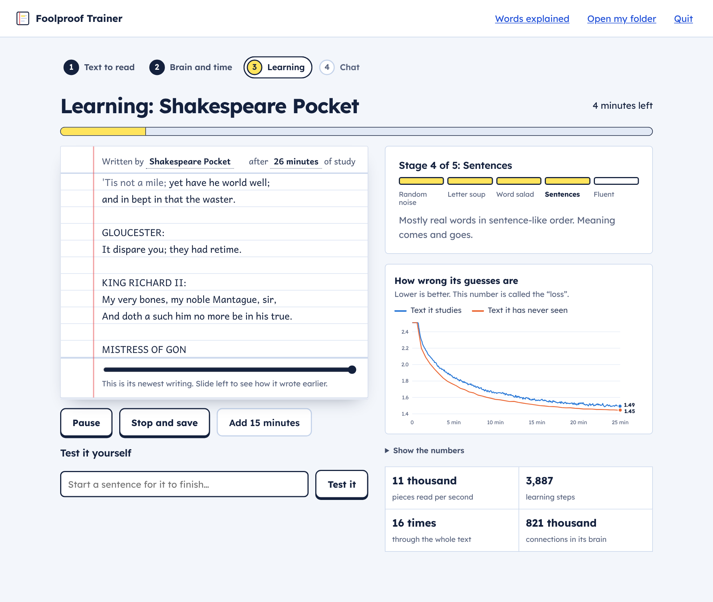
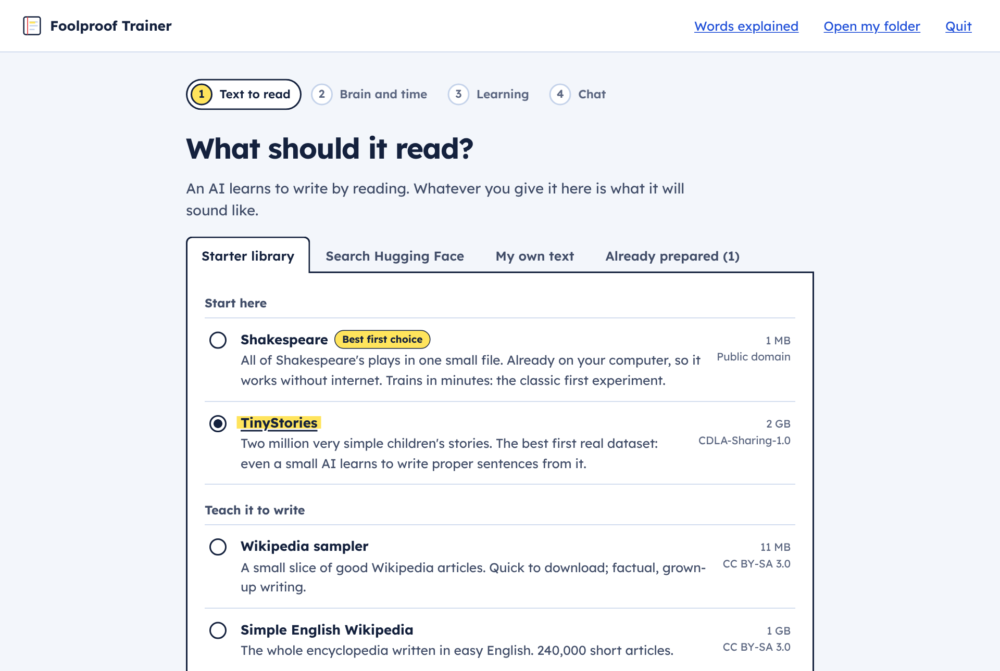
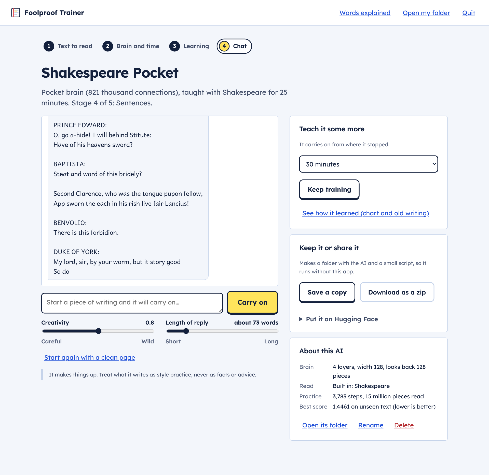
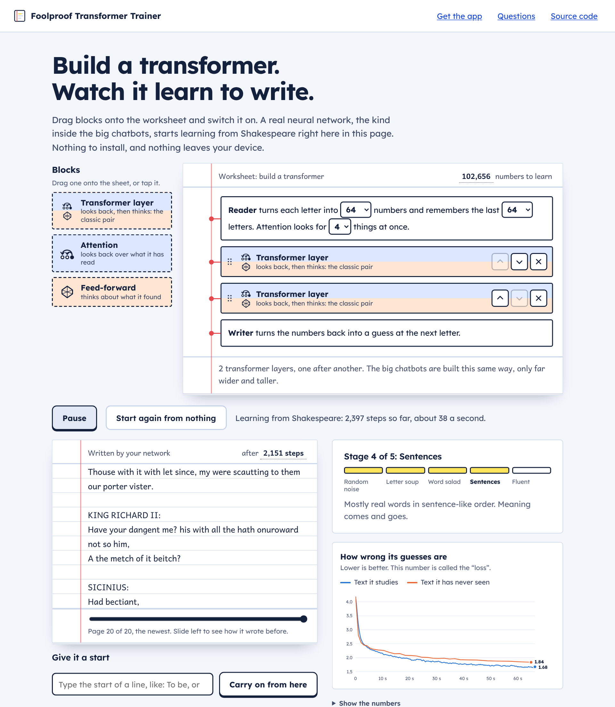

# Foolproof Transformer Trainer

**Train your own small AI on your own computer. No coding, no accounts, nothing to pay.**

Pick some text for it to read, press Start, and watch it learn to write. Then talk to it.

**Want a taste first? [Build a transformer in your browser](https://marxist-leninist.github.io/foolproof-transformer-trainer/):
drag the blocks, switch it on, and watch a real one learn. Nothing to install.**



It is a real GPT-style transformer, trained from scratch, the same kind of brain as the famous
chatbots, only much smaller. You do not need to know what any of those words mean.

---

## Get it running

The first start downloads what it needs (a few minutes, needs internet, about 2 GB of disk,
or 5 GB if you have an NVIDIA graphics card). After that it starts in seconds and works offline.

### Windows 10 or 11

1. **[Download the ZIP](https://github.com/Marxist-Leninist/foolproof-transformer-trainer/archive/refs/heads/main.zip)**
   and open it (double-click it in your Downloads folder).
2. Inside, double-click **START-WINDOWS.bat**.
   If Windows asks whether to *Extract all* or *Run*, choose **Run**.
3. Wait while the black window sets things up. Your browser then opens by itself.

It puts a **Foolproof Trainer** icon on your Desktop. Double-click that next time.

If Windows shows a blue box saying *“Windows protected your PC”*, click **More info**, then
**Run anyway**. Windows shows that for every program that has not bought a certificate from Microsoft.

### Mac

1. Open the **Terminal** app: press `Cmd`+`Space`, type `Terminal`, press `Enter`.
   (Or open Finder, then Applications, then Utilities, and double-click Terminal.)
2. Copy the line below (click the copy button at its right-hand end), click on the Terminal
   window, paste with `Cmd`+`V`, and press `Enter`:

   ```
   curl -fsSL https://raw.githubusercontent.com/Marxist-Leninist/foolproof-transformer-trainer/main/start.sh | bash
   ```
3. Wait while it sets things up. Your browser then opens by itself.

It puts a **Foolproof Trainer** icon on your Desktop. Double-click that next time.

### Linux

The same one line as on a Mac. It adds *Foolproof Trainer* to your applications menu.
(Or download the ZIP, unpack it, and run `./start.sh`.)

---

## What you do in it

| | |
|---|---|
| **1. Give it something to read** | A built-in starter library (Shakespeare works with no internet at all; TinyStories is the best first real one), a search box for the whole of Hugging Face, or your own files: drop in text files, Word documents, PDFs, ebooks, spreadsheets, a whole folder, or just paste text. |
| **2. Pick a brain size and a time** | The app looks at your computer and your text and recommends a size. Or choose **Build it yourself** and stack the blocks by hand: what you stack is what gets trained. Then: 5 minutes, 30 minutes, overnight, or until you stop it. |
| **3. Watch it learn** | Its own writing appears on a sheet of paper and improves in front of you: random letters, then word-shaped nonsense, then sentences. Slide back in time to see how it wrote earlier. A five-step ladder and a chart show how far it has got, in plain words. |
| **4. Talk to it** | Chat with it, or start a sentence and let it carry on. Train it further, save a copy that runs without this app, or put it on Hugging Face. |





---

## What to expect

A small AI learns the **style** of what it reads: its words, its rhythm, how its sentences are
built. It does not learn facts and it cannot hold a real conversation. The chatbots you have
used are around 100,000 times bigger and have read a large part of the internet.

| Your computer | A sensible first run | What you get |
|---|---|---|
| Any laptop, no graphics card | Shakespeare, *Pocket* brain, 5 to 30 minutes | Shakespeare-shaped nonsense: real short words, invented long ones, the look of a play. |
| NVIDIA card with 6 to 8 GB, or an Apple Silicon Mac | TinyStories, *Small* brain, 30 minutes to 2 hours | Short children's stories in proper sentences. They wander, but they read as English. |
| NVIDIA card with 12 GB or more | TinyStories or Simple Wikipedia, *Medium* or *Large* brain, overnight | Fluent paragraphs in the style of the text. |

These are rough guides, not promises. More text and more time always help; a bigger brain only
helps if it has enough text to learn from (the app warns you when it does not).

---

## Questions

**Do I need a graphics card?**
No. Without one it uses the main processor, which is fine for the small brain sizes.
An NVIDIA card or an Apple Silicon Mac is many times faster and lets you use bigger ones.
Older NVIDIA cards (GTX 900 and 1000 series) work too: the app installs the last PyTorch that supports them.
AMD and Intel graphics cards are not used yet; the app falls back to the processor.

**Is anything uploaded?**
No. Training happens on your computer and your files never leave it. The app only goes online
to fetch things: its own setup the first time, and any text you choose from Hugging Face.
Nothing is sent anywhere unless you press *Upload it* to publish an AI on Hugging Face yourself.

**Where are my AIs kept?**
In a folder called `FoolproofTrainer` in your home folder. *Open my folder* in the app takes you there.
Re-downloading or updating the app does not touch it.

**Can I close it while it is training?**
Yes. Progress is saved every few minutes and whenever you press *Stop and save*.
Open the app again and press *Keep training* to carry on.

**How do I update it?**
Windows: download the ZIP again and run START-WINDOWS.bat from it, exactly like the first time.
Mac and Linux: run the one line again with `FOOLPROOF_UPDATE=1` in front of `bash`.
Your AIs and the installed PyTorch are kept.

**How do I remove it?**
Delete the Desktop icon and these two folders:

| | Engine room (Python, PyTorch) | Your AIs and prepared text |
|---|---|---|
| Windows | `%LOCALAPPDATA%\FoolproofTrainer` | `%USERPROFILE%\FoolproofTrainer` |
| Mac | `~/Library/Application Support/FoolproofTrainer` | `~/FoolproofTrainer` |
| Linux | `~/.local/share/foolproof-trainer` | `~/FoolproofTrainer` |

Nothing else is installed anywhere and nothing is added to your system settings.

**Can I watch it from my phone?**
Start it with `--lan` (for example `START-WINDOWS.bat --lan`). It prints a private link to open on
a phone that is on the same Wi-Fi. Only someone with that link can get in.

**The website does not work on my phone or tablet.**
Open the [device check](https://marxist-leninist.github.io/foolproof-transformer-trainer/check.html) on it.
In about half a minute it says which parts work on that device and which do not. Copy the result from
the bottom of that page into an
[issue](https://github.com/Marxist-Leninist/foolproof-transformer-trainer/issues).

**Something went wrong.**
Run the launcher with `--selftest` (for example `START-WINDOWS.bat --selftest`). It checks every
part in about a minute and says which one failed. Then
[open an issue](https://github.com/Marxist-Leninist/foolproof-transformer-trainer/issues) and paste what it printed.

---

## For the curious: what is inside

Everything is in the [`foolproof`](foolproof) folder, in plain Python with no framework on top of PyTorch.

- **The brain** ([`model.py`](foolproof/model.py)): a decoder-only transformer with rotary position
  embeddings, RMSNorm pre-normalisation, flash attention, tied input and output embeddings, and a
  key/value cache for fast chatting. Six sizes from 0.8 million to 300 million parameters.
- **Reading text** ([`data.py`](foolproof/data.py), [`hub.py`](foolproof/hub.py),
  [`textio.py`](foolproof/textio.py)): Hugging Face datasets are streamed straight out of their
  parquet files with HTTP range requests, so taking the first few million tokens of a 50 GB
  dataset downloads megabytes, not gigabytes. No `datasets` library and no dataset loading scripts.
  The text column, or the question and answer columns, or the chat messages, are found automatically.
- **Tokenizers** ([`tokenizers.py`](foolproof/tokenizers.py)): chosen by the amount of text.
  Letter by letter (bytes) for small text, a byte-level BPE vocabulary trained on your own text for
  medium amounts, and OpenAI's `tiktoken` vocabularies for large English corpora. You can override the choice.
- **Training** ([`worker.py`](foolproof/worker.py)): AdamW, mixed precision on NVIDIA cards, and a
  learning-rate schedule driven by the clock, so “train for 30 minutes” means the same on any
  machine. If the graphics card runs out of memory, the batch is halved and training carries on.
  The best version on held-out text is kept, and training stops by itself when it starts memorising.
- **The progress ladder**: when text is prepared, two simple yardsticks are measured on it: how
  well you could predict it knowing only how common each piece is, and knowing only the piece
  before. The five stages are set relative to those, so they mean the same for letter-by-letter
  Shakespeare as for word-piece Wikipedia.
- **Hand-built designs** ([`architecture.py`](foolproof/architecture.py)): the builder sends a short
  description (width, heads, memory, and the list of blocks); it is checked strictly, turned into
  the model, and kept in the model's settings.
- **The window** ([`server.py`](foolproof/server.py), [`web/`](foolproof/web)): a small local web
  server from the Python standard library and a page with no framework and no build step. It only
  listens on your own computer, and every request needs a secret made fresh at each start.
- **The launchers** ([`START-WINDOWS.bat`](START-WINDOWS.bat), [`start.sh`](start.sh)): fetch
  [uv](https://github.com/astral-sh/uv), which installs a private Python 3.12 and the PyTorch build
  that matches your graphics card.

### Running from source

```
pip install torch
pip install -r requirements.txt
python -m foolproof              # start the app
python -m foolproof --selftest   # check everything end to end
```

Every push is tested by starting the real launchers on Windows, macOS and Linux machines
([workflow](.github/workflows/launchers.yml)): they install everything from nothing, prepare text,
train a miniature AI (a ready-made size, and a hand-built design through the app's own window),
chat with it and shut down.

The builder and the website have their own checks ([workflow](.github/workflows/site.yml)), and a
[second workflow](.github/workflows/devices.yml) runs the website in Safari on a Mac and in Safari on
an iPhone simulator:

```
node tests/web/test_nn.js                  # the in-page network: gradients, design rules, WebAssembly vs JavaScript
python tests/web/parity.py                 # the in-page network against the app's PyTorch model
python -m unittest discover -s tests -v    # the app's design checker and custom models
python tests/web/browser_check.py          # website and app builder in a real browser: mouse, keyboard, touch
python tests/web/device_check.py playwright chromium   # the device self-check page (docs/check.html)
python tests/web/safari_check.py           # on a Mac: the website in Safari itself, through safaridriver
python tools/sync_site.py                  # after changing foolproof/web: refresh the website's copies
```

## The block builder

In the app, at **How big a brain?**, choose **Build it yourself**. On the
[website](https://marxist-leninist.github.io/foolproof-transformer-trainer/) it is the first thing on the page.
It is the same builder in both places.



- **Drag** a block from the tray onto the worksheet, drag blocks up and down to re-order them, and
  drag one back to the tray to take it off. With a mouse, drag from anywhere on a block; on a
  touch screen, drag by its dotted handle (so the page still scrolls under your finger).
- **Or do not drag at all:** tap a block in the tray to add it, and use the up, down and remove
  buttons on each block. With a keyboard: Tab to a block, then Alt+Up, Alt+Down or Delete.
- Three kinds of block: **Attention** (looks back over what it has read), **Feed-forward** (thinks
  about what it found) and **Transformer layer** (one of each, the classic pair). The width, the
  memory and the number of attention heads are drop-downs that only offer values that work.
- The stack is the model. It is not a picture of one: the trainer builds exactly those blocks in
  exactly that order, and saves the order with the model, so it survives pausing, more training
  and exporting.

The app checks a hand-built design against your computer before training and says so in words
if it is too big. Limits: up to 16 blocks, width 32 to 768, 1 to 16 heads, memory (context) 32 to
1,024, at least one block that looks back, and 350 million parameters. These are limits on what
it will accept, not a promise that the largest design is a sensible one for your machine.

A design made on the website has a short code such as `fp1-w64-h4-c64-tta`. Paste it into the
app to carry on with the same stack at full size.

### The network on the website is real

The website trains the stack you built inside the page: a transformer written out by hand in
JavaScript ([`docs/nn.js`](docs/nn.js)), with the heavy multiplying in WebAssembly
([`docs/kernels.c`](docs/kernels.c)), running in a worker on your own processor. It is small
(up to a few hundred thousand parameters, learning one letter at a time), and it does the same
sums as the app's PyTorch model:

- every hand-written gradient is checked against finite differences;
- the same weights are loaded into the app's PyTorch model and into the page's network, under
  PyTorch's own parameter names, and the scores, the loss and every gradient must agree. They do,
  to about one part in a million;
- the WebAssembly loops are checked against the plain JavaScript ones, which remain as the path
  for browsers without WebAssembly SIMD.

## Licence

[MIT](LICENSE). Bundled fonts and the Shakespeare text are listed in [THIRD-PARTY.md](THIRD-PARTY.md).
Each dataset in the starter library has its own licence, shown next to it in the app.
